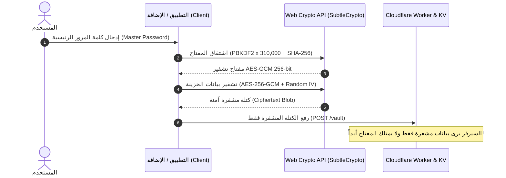
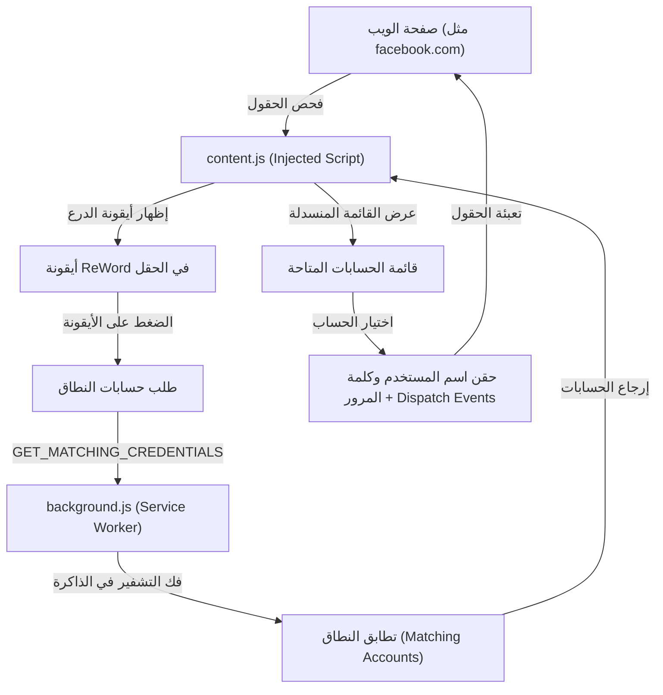
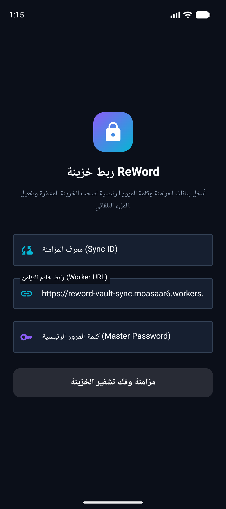

<p align="center">
  
</p>

# 🛡️ ReWord - Secure Zero-Knowledge Password Manager & Autofill Suite
### مدير كلمات المرور الآمن والمشفر بمبدأ المعرفة الصفرية (Zero-Knowledge) مع الملء التلقائي (Autofill)

[](https://reword-app.pages.dev/)
[](https://workers.cloudflare.com/)
[](./extension)
[](./android)
[-blueviolet)](#-security--cryptography-model)
[](LICENSE)

---

## 🌟 نظرة عامة (Overview)

**ReWord** هو نظام متكامل لإدارة كلمات المرور وتأمين الهوية الرقمية، مصمم وفق مبدأ **المعرفة الصفرية (Zero-Knowledge)**. يعمل بدون إنترنت (Offline-First) كـ Progressive Web App (PWA)، ويتزامن سحابياً وبشكل مشفر تماماً عبر خوادم **Cloudflare Workers & KV**، مع **إضافة متصفح (Chrome Extension - Manifest V3)** تدعم ميزة **الملء التلقائي (Autofill)** الذكي داخل صفحات تسجيل الدخول.

> [!IMPORTANT]
> **مبدأ المعرفة الصفرية (Zero-Knowledge):** لا يتم إرسال كلمة المرور الرئيسية أو أي بيانات غير مشفرة إلى أي خادم على الإطلاق. عمليات التشفير وفك التشفير تتم محلياً 100% داخل جهاز المستخدم باستخدام واجهة `Web Crypto API` القياسية.

---

## ✨ المميزات الرئيسية (Core Features)

* 🔐 **تشفير قياسي فائق الأمان (Military-Grade Encryption):**
  * تشفير متماثل **AES-256-GCM** مع Salt فريد (32 بايت) و IV عشوائي (12 بايت) لكل عملية حفظ.
  * اشتقاق المفاتيح عبر **PBKDF2 مع SHA-256 بـ 310,000 تكرار** (مطابق لتوصيات OWASP لمقاومة هجمات القوة الغاشمة).
  * حماية هويات المزامنة بتوليد SHA-256 Hashes لا يمكن عكسها (`reword:v1:${syncId}`).

* ⚡ **إضافة جوجل كروم للملء التلقائي (Chrome Extension Autofill v1.1.1):**
  * إضافة مبنية وفق أحدث معايير **Manifest V3** مع شعار ReWord الرسمي المحدّث.
  * محرك كشف فوري ذكي من 5 طبقات (`isFieldVisible`) لفحص الحقول النشطة ومنع الأيقونات الشبحية.
  * زر درع تفاعلي داخل حقول اسم المستخدم وكلمات المرور في أي موقع.
  * نظام تنظيف تلقائي فوري للأيقونات عند تسجيل الدخول (`submit`, `click`, `Enter`, SPA route change).
  * قائمة منسدلة فورية لاقتراح الحسابات المتطابقة مع النطاق الحالي (Domain).
  * تعبئة تلقائية فائقة السرعة بضغطة زر مع دعم أطر العمل الحديثة (React, Vue, Angular).
  * قفل تلقائي ذكي بعد فترة عدم نشاط لحماية البيانات، وإدارة ذكية للموارد عبر وضع السكون `(inactive)`.

* ☁️ **مزامنة سحابية فائقة الخفة (Cloudflare Serverless Sync):**
  * استخدام **Cloudflare Worker** كخادم وسيط بدون خوادم تقليدية.
  * تخزين البيانات المشفرة كـ Encrypted Blobs في **Cloudflare KV**.
  * حماية ضد تعارض التعديلات (Conflict Detection) بالاعتماد على الطوابع الزمنية (`timestamp`).

* 📱 **تطبيق ويب تقدمي (PWA & Offline First):**
  * تخزين محلي آمن في المتصفح باستخدام **IndexedDB**.
  * ملف `sw.js` (Service Worker) لتشغيل التطبيق والوصول للخزينة بدون اتصال بالإنترنت.
  * واجهة مستخدم عربية وأنيقة مع تصميم داكن عصري مستوحى من أفضل أدوات الإنتاجية.

* 🔄 **إدارة البيانات والنسخ الاحتياطي (Import & Export):**
  * تصدير واستيراد الخزائن المشفرة بامتداد `.reword`.
  * استيراد كلمات المرور من المتصفحات وتطبيقات مثل Bitwarden عبر ملفات CSV.
  * تصدير تقارير الجداول بتنسيق Excel XLSX.

---

## 🏗️ آلية العمل والمعمارية (How It Works)

```
┌────────────────────────────────────────────────────────┐
│             جهاز المستخدم (Client-Side)                │
│                                                        │
│  [ المتصفح / PWA ]   أو   [ إضافة كروم Extension ]     │
│        │                          │                    │
│   (IndexedDB)                 (Autofill)               │
│        │                          │                    │
│        ▼                          ▼                    │
│    Web Crypto API: PBKDF2 (310k) + AES-256-GCM         │
│  (التشفير وفك التشفير يحدث هنا فقط داخل جهازك!)       │
└───────────────────────────┬────────────────────────────┘
                            │
              يرسل فقط بيانات مشفرة بالكامل
                   (Encrypted Blob)
                            │
                            ▼
┌────────────────────────────────────────────────────────┐
│             سيرفرات Cloudflare (Serverless)            │
│                                                        │
│   [ Cloudflare Worker: reword-vault-sync ]             │
│        │                                               │
│        ▼                                               │
│   [ Cloudflare KV: vaults ]                            │
│   (تخزن كتل البيانات المشفرة دون معرفة محتواها أبداً)  │
└────────────────────────────────────────────────────────┘
```

### 1. طبقة التشفير الفائق (The Cryptography Engine):
* **كلمة المرور الرئيسية (Master Password):** لا تغادر جهازك إطلاقاً ولا تُحفظ في أي قاعدة بيانات.
* **اشتقاق المفتاح:** عند إدخال كلمة المرور، تُمرر لخوارزمية **PBKDF2 مع SHA-256 بعدد 310,000 دورة تكرار** لتوليد مفتاح تشفير 256-bit فائق القوة مع Salt بحجم 32 بايت.
* **التشفير المتماثل:** تُشفر الخزينة بالكامل بخوارزمية **AES-256-GCM** مع `IV` عشوائي (12 بايت) لكل عملية حفظ.
* **معرّف المزامنة (Sync ID):** لا يُرسل كما هو للسيرفر، بل يتم تحويله إلى كود تشفيري عبر **SHA-256 Hash** (`reword:v1:${syncId}`).

### 2. طبقة السحابة (Cloudflare Worker & KV):
* الـ Worker هو دالة سحابية خفيفة جداً وسريعة (`worker/index.js`).
* **دوره:** استلام الكتلة المشفرة وتخزينها في قاعدة بيانات **Cloudflare KV** السريعة والموزعة عالمياً.
* **حماية التضارب (Conflict Detection):** يقارن الـ Worker الطابع الزمني (`timestamp`) للخزينة لضمان عدم الكتابة فوق تعديل أحدث من جهاز آخر.

### 3. تدفق التشفير وفك التشفير (Client-Side Encryption Sequence)



---

### 4. تدفق الملء التلقائي للإضافة (Chrome Extension Autofill Pipeline)



---

## 📖 دليل الاستخدام التفصيلي (How to Use)

### أولاً: كيفية استخدام موقع الويب (ReWord Web App / PWA)

1. **إنشاء الخزينة لأول مرة:**
   * ادخل على الموقع: [reword-app.pages.dev](https://reword-app.pages.dev/).
   * اختر **"إنشاء خزينة جديدة"** وأدخل كلمة مرور رئيسية قوية (واحفظها جيداً).
   * يمكنك كتابة تلميح (Hint) لمساعدتك على تذكرها، وتعيين **Sync ID** للمزامنة مع رابط الـ Worker.
2. **إضافة الحسابات:**
   * اضغط **"+ إضافة موقع"** وأدخل اسم الموقع واسم المستخدم وكلمة المرور (أو اضغط زر التوليد السريع ⚡ لإنشاء كلمة مرور معقدة).
3. **العمل بدون إنترنت (Offline Mode):**
   * التطبيق مدعوم بتقنية PWA، يمكنك تثبيته على جهازك وسيعمل بكفاءة عبر IndexedDB حتى بدون اتصال بالشبكة.
4. **المزامنة والربط بين الأجهزة:**
   * من أي جهاز جديد، افتح الموقع واختر **"ربط خزنة موجودة"** وأدخل نفس الـ Sync ID وكلمة المرور لجلب بياناتك المشفرة فوراً.
5. **النسخ الاحتياطي:**
   * من الإعدادات يمكنك تصدير ملف `.reword` مشفر، أو استيراد وتصدير كلمات المرور عبر CSV و Excel XLSX.

---

### ثانياً: كيفية استخدام إضافة المتصفح (Chrome Extension)

1. **تثبيت الإضافة في المتصفح:**
   * افتح `chrome://extensions/` في متصفح Google Chrome (أو أي متصفح مبني على Chromium).
   * فعّل وضع المطور **Developer mode** من الزاوية العلوية.
   * اضغط على **Load unpacked** واختر مجلد `extension`.
2. **تثبيت وفتح الإضافة من شريط المتصفح العلوي (مهم):**
   * اضغط على أيقونة **قطعة البازل (🧩 Extensions)** في شريط المتصفح العلوي.
   * اضغط على علامة **الدبوس (📌 Pin)** بجانب **ReWord** لتثبيتها في الشريط.
   * انقر مباشرة على أيقونة درع ReWord في الشريط لفتح واجهة الخزينة المنبثقة (Popup).
   > [!TIP]
   > صفحة `chrome://extensions` هي لإدارة الإضافات فقط ولا تفتح الواجهة عند النقر على البطاقة. كما أن ظهور حالة `service worker (inactive)` هو سلوك طبيعي لتوفير موارد الجهاز والبطارية في معيار Manifest V3.
3. **ربط الإضافة بالخزينة:**
   * أدخل الـ **Sync ID** ورابط الـ Worker وكلمة المرور الرئيسية لجلب بياناتك المشفرة وفك تشفيرها محلياً.
4. **الملء التلقائي في أي موقع (Autofill):**
   * عند زيارة أي موقع به حقول تسجيل دخول (مثل Facebook, Google, GitHub):
     * ستظهر أيقونة درع ReWord تلقائياً داخل الحقل، اضغط عليها لاختيار الحساب والتعبئة بضغطة زر واحدة.
     * أو افتح الإضافة من الشريط العلوي واضغط على زر **"تعبئة ⚡"** في قسم الموقع الحالي.
   * عند إرسال النموذج أو الضغط على زر الدخول أو زر Enter، تختفي الأيقونات فوراً وبشكل تلقائي.
5. **حفظ وتوليد الحسابات بسهولة:**
   * يمكنك الضغط على **"+ إضافة حساب جديد"** من الإضافة لحفظ الحساب مع تعبئة رابط الموقع الحالي تلقائياً، أو استخدام مولد كلمات المرور المعقدة ⚡.

---

### ثالثاً: كيفية استخدام وبناء تطبيق الأندرويد (Android Native App)

1. **بناء وتشغيل التطبيق عبر Android Studio:**
   * افتح مجلد `android` في **Android Studio** (نسخة Iguana 2023.2.1 أو أحدث).
   * انتظر حتى تكتمل مزامنة ملفات Gradle تلقائياً (`Gradle Sync`).
   * وصّل هاتف أندرويد (Android 8.0+) أو شغّل محاكي Android Emulator، ثم اضغط **Run**.
2. **تسجيل الدخول ومزامنة الخزينة المشفرة:**
   * افتح تطبيق **ReWord** على الهاتف.
   * أدخل الـ **Sync ID** وكلمة المرور الرئيسية ورابط الـ Worker (أو اتركه على الرابط الافتراضي).
   * اضغط **"فتح الخزينة ومزامنتها"** ليتم جلب وفك تشفير الخزينة محلياً 100%.
3. **تفعيل الملء التلقائي في كافة تطبيقات ومتصفحات الهاتف (Autofill Service):**
   * انتقل إلى تبويب **الإعدادات (Settings)** داخل التطبيق.
   * اضغط زر **"فتح إعدادات الملء التلقائي بالنظام"**.
   * اختر **ReWord** كخدمة الملء التلقائي الافتراضية للجهاز.
4. **الملء التلقائي الفوري والمصادقة بالبصمة (Biometrics):**
   * عند فتح أي تطبيق (مثل Facebook, X, تطبيق البنك) أو متصفح ويب في الهاتف:
   * اضغط على حقل اسم المستخدم أو كلمة المرور، ستظهر لك بطاقة ReWord الذكية.
   * اختر حسابك، وأكّد العملية ببصمة الإصبع أو الوجه (`BiometricPrompt`) ليتم ملء البيانات فوراً!

---

## 📂 هيكل المشروع (Project Structure)

```text
├── core.js                 # المحرك الأساسي (التشفير، IndexedDB، المزامنة، منطق الخزينة)
├── ui.js                   # واجهة المستخدم وتفاعلات القوائم والمودالات والبحث
├── index.html              # الصفحة الرئيسية لتطبيق الويب (PWA)
├── style.css               # الأنماط والتصميم الداكن المتجاوب
├── sw.js                   # Service Worker للعمل أوفلاين كـ PWA
├── manifest.json           # إعدادات تطبيق الويب التقدمي (PWA Manifest)
├── icon.png                # أيقونة التطبيق الرسمية
│
├── worker/
│   └── index.js            # كود Cloudflare Worker لمعالجة المزامنة المشفرة
├── wrangler.toml           # ملف إعدادات Wrangler وربط KV Namespace
│
├── extension/              # إضافة جوجل كروم (Manifest V3)
│   ├── manifest.json       # تعريف الإضافة والأذونات
│   ├── background.js       # مشغل الخدمة في الخلفية (Session Cache, Sync, Auto-lock)
│   ├── content.js          # سكربت الكشف والملء التلقائي داخل صفحات الويب
│   ├── content.css         # أنماط الأيقونة والقائمة المنسدلة العائمة
│   ├── crypto.js           # وحدة التشفير المتوافقة بنسبة 100% مع core.js
│   ├── popup.html          # واجهة نافذة الإضافة السريعة
│   ├── popup.js            # منطق واجهة الإضافة وتعبئة الصفحة النشطة بضغطة زر
│   ├── popup.css           # أنماط الواجهة السريعة
│   └── icons/              # أيقونات الإضافة بأحجامها المختلفة
│
├── android/                # تطبيق أندرويد الأصلي المتكامل (Native Kotlin & Jetpack Compose)
│   ├── app/                # وحدة التطبيق (UI, Crypto, Service, Network, Model)
│   ├── build.gradle.kts    # إعدادات بناء Gradle للمشروع
│   └── README.md           # دليل تشغيل وتثبيت تطبيق الأندرويد
│
├── ANDROID_AUTOFILL_PLAN.md# وثيقة وخطة تطبيق الأندرويد القادم (Autofill Service & Biometrics)
├── knowledge.owl           # خريطة المعرفة والأنطولوجيا الرسمية للمشروع (OntoLink Graph)
└── README.md               # الدليل الشامل والمفصل للمشروع
```

---

## 🚀 التثبيت والتشغيل المحلي (Getting Started)

### 1. تشغيل موقع الويب محلياً:
بما أن المشروع يعتمد على معايير الويب الصافية (Vanilla HTML/CSS/JS)، يمكنك تشغيله باستخدام أي خادم محلي:
```bash
npx serve .
# أو
python -m http.server 8080
```
افتح المتصفح على `http://localhost:8080`.

---

### 2. تثبيت إضافة كروم (Chrome Extension):
1. افتح متصفح Chrome أو أي متصفح مبني على Chromium (Edge, Brave, Opera).
2. ادخل إلى الرابط: `chrome://extensions/`.
3. قم بتفعيل **Developer Mode** (وضع المطور) من الزاوية العلوية.
4. اضغط على **Load unpacked** (تحميل حزمة غير مضغوطة).
5. اختر مجلد `extension` من داخل مسار هذا المشروع.
6. افتح الإضافة، أدخل الـ Sync ID وكلمة المرور لفك التشفير وابدأ بالملء التلقائي في أي موقع!

---

### 3. نشر الـ Worker على Cloudflare:
إذا أردت نشر الـ Worker بنفسك على حسابك في Cloudflare:
```bash
npx wrangler login
npx wrangler kv namespace create vaults
# ضع الـ ID الناتج في wrangler.toml
npx wrangler deploy
```

---

### 4. بناء وتشغيل تطبيق أندرويد (Android Studio):
1. افتح مجلد `android` باستخدام **Android Studio** (نسخة Iguana أو Koala أو أحدث).
2. سيقوم Android Studio بمزامنة حزم Gradle تلقائياً (`Gradle Sync`).
3. اختر محاكي (Emulator) أو هاتف أندرويد حقيقي يعمل بنظام Android 8.0 (API 26) فما فوق.
4. اضغط على زر **Run 'app'** (أو اختصار `Shift + F10`).
5. راجع الدليل المخصص في [`android/README.md`](./android/README.md) لمزيد من التفاصيل.

---

## 📱 تطبيق أندرويد الأصلي والملء التلقائي للنظام (Native Android App & System-Wide Autofill)

تمت إضافة تطبيق أندرويد أصلي (Native) متكامل مكتوب بلغة **Kotlin** مع أحدث واجهات **Jetpack Compose (Material 3)**، ليوفر تجربة أمان وملء تلقائي شاملة على الهواتف الذكية:

<p align="center">
  
</p>

### 🌟 أبرز مميزات تطبيق الأندرويد:
1. **الملء التلقائي الشامل للنظام (Android Autofill Framework):**
   * خدمة `ReWordAutofillService` القياسية المتوافقة مع أندرويد 8.0 فما فوق.
   * التعرف التلقائي على حقول اسم المستخدم وكلمات المرور في **كافة التطبيقات** (مثل تطبيقات التواصل والبنوك والتسوق) وفي **جميع متصفحات الهواتف** (Chrome, Edge, Firefox, Samsung Internet).
   * قائمة منسدلة فورية تظهر فوق حقول الإدخال لتعبئة الحساب المختار بلمسة واحدة.

2. **المصادقة البيومترية والأمان العتادي (Biometrics & Android Keystore):**
   * فتح الخزينة وتأكيد عمليات الملء التلقائي باستخدام **بصمة الإصبع أو بصمة الوجه (Fingerprint / Face ID)** عبر `BiometricPrompt`.
   * تشفير وحماية مفتاح فك التشفير بواسطة عتاد الهاتف المشفر **Android Keystore (Hardware-backed)** لضمان أقصى درجات الحماية.

3. **تطابق تشفيري 100% مع الويب والإضافة (`core.js`):**
   * اشتقاق المفاتيح بخوارزمية **PBKDF2 مع HMAC-SHA256 بـ 310,000 دورة تكرار** ونفس حجم الـ Salt (32 بايت).
   * تشفير متماثل **AES-256-GCM** مع علامة مصادقة 128-bit و IV عشوائي (12 بايت) لكل عملية حفظ.
   * إمكانية فتح ومزامنة نفس الخزينة بين موقع الويب، وإضافة كروم، وتطبيق الأندرويد بسلاسة وأمان تام.

4. **مزامنة سحابية بمبدأ المعرفة الصفرية (Cloudflare Worker Zero-Knowledge Sync):**
   * يتصل التطبيق بنفس خادم Cloudflare Worker (`/vault`) لجلب ورفع كتل البيانات المشفرة (Encrypted Blobs).
   * لا يمكن للخادم فك تشفير البيانات لأن التشفير وفك التشفير يتم محلياً على جهازك فقط.

5. **واجهة مستخدم عصرية وأنيقة (Jetpack Compose & Material 3):**
   * خط عربي محلي أنيق **Alexandria** مع فرض اتجاه القراءة من اليمين إلى اليسار (RTL) ودعم سلس للنصوص والرموز الإنجليزية.
   * ضبط دقيق لمساحات الأمان العلوية والسفلية (Safe Area Insets & Status/Navigation Bars Padding).
   * أيقونات وألوان المواقع الحقيقية (Favicons) مستنسخة من الويب مع رسوم متحركة سلسة لفتح وغلق البطاقات وقوائم الحسابات.
   * شاشة ربط الخزينة عبر **Sync ID** ورابط الـ Worker.
   * شاشة استعراض وبحث فوري في المواقع والحسابات مع إمكانية نسخ اسم المستخدم وكلمات المرور بلمسة واحدة.
   * شاشة إعدادات للتحكم بالبصمة البيومترية وفتح إعدادات الملء التلقائي في النظام مباشرة بضغطة زر.

6. **خدمات الملء المساعدة والزر العائم (Floating Shield & Quick Settings):**
   * **زر الدرع العائم (`FloatingShieldService`):** أيقونة درع ReWord عائمة فوق التطبيقات لتعبئة الحسابات في أي لحظة مثل إضافة كروم.
   * **خدمة إمكانية الوصول (`ReWordAccessibilityService`):** لدعم التطبيقات والحقول التي لا تدعم إطار الـ Autofill التقليدي تلقائياً.
   * **زر الإعدادات السريعة (`ReWordTileService`):** إمكانية فتح واختيار الحسابات مباشرة من لوحة الإشعارات العلوية (Quick Settings Shade).

---

## 🗺️ خريطة الأنطولوجيا وخطة التطوير (Roadmap & Ontology)

المشروع مسجل ومنظم بالكامل عبر نظام **OntoLink** المعرفي في [`knowledge.owl`](./knowledge.owl).

### 📱 مهمة أندرويد والملء التلقائي (Android Autofill & Biometrics):
* [x] **توثيق الخطة التقنية:** [`ANDROID_AUTOFILL_PLAN.md`](./ANDROID_AUTOFILL_PLAN.md).
* [x] **`task-android-setup`:** إعداد مشروع أندرويد (Kotlin / Jetpack Compose).
* [x] **`task-android-crypto`:** تشفير AES-256-GCM و PBKDF2 على أندرويد ومزامنة الـ Worker.
* [x] **`task-android-autofill`:** برمجة `AutofillService` لنظام أندرويد للملء في كل التطبيقات والمواقع.
* [x] **`task-android-biometrics`:** تكامل التحقق ببصمة الإصبع أو الوجه (`BiometricPrompt` + Keystore).
* [x] **`task-android-ui-sync`:** بناء واجهات إدخال الـ Sync ID والربط السحابي والزر العائم والخطوط المحلية.

> [!NOTE]
> 🎉 **تم إنجاز تطبيق الأندرويد وإضافة المتصفح v1.1.1 بنجاح تام!** يتوفر التطبيق الأصلي كاملاً الآن في مجلد [`android/`](./android) مع دعم الـ Autofill Service الشامل، والزر العائم، والمصادقة البيومترية (BiometricPrompt)، وتشفير متطابق بنسبة 100% مع الويب وإضافة كروم.

---

## 🔒 ترخيص الاستخدام (License)
هذا المشروع مرخص تحت رخصة **MIT** - راجع ملف [LICENSE](LICENSE) لمزيد من التفاصيل.
